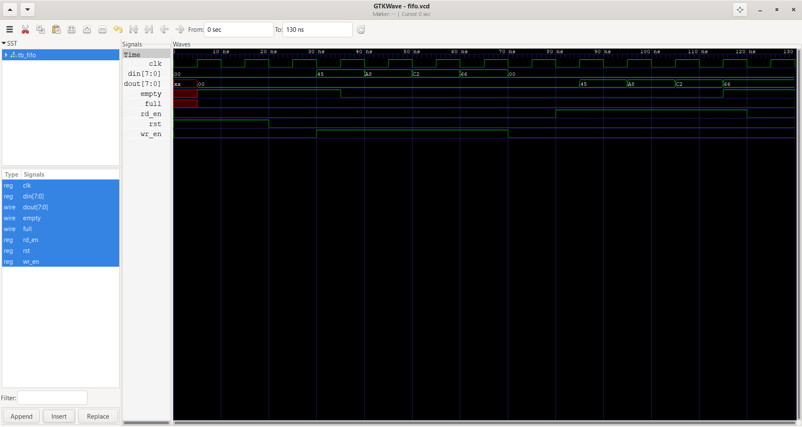

# Synchronous-FIFO-Design-and-Verify-using-Verilog
Designed and verified an 8-bit wide, 8-depth synchronous FIFO using Verilog HDL. Implemented write and read operations, read/write pointers, occupancy counter, and full/empty status flags. Created a testbench using Icarus Verilog to simulate FIFO functionality and verify data ordering.

# Synchronous FIFO Design and Verification using Verilog

## Overview
This project implements and verifies an 8-bit wide, 8-depth Synchronous FIFO (First-In, First-Out) using Verilog HDL.

A FIFO is a memory structure in which data is read in the same order in which it was written. This design uses a common clock for both read and write operations and includes status flags to indicate when the FIFO is full or empty.

## Features
- 8-bit data width
- 8 memory locations
- Synchronous active-high reset
- Write and read operations
- Read and write pointers
- Occupancy counter to track stored data
- Full and empty status flags
- Verilog testbench for functional verification

## Design Specifications

| Parameter | Description |
|---|---|
| Design Type | Synchronous FIFO |
| Data Width | 8 bits |
| FIFO Depth | 8 locations |
| Clock | Common clock |
| Reset | Synchronous, active-high |
| HDL | Verilog |
| Simulator | Icarus Verilog |
| Waveform Viewer | GTKWave |

## Input and Output Signals

| Signal | Direction | Description |
|---|---|---|
| `clk` | Input | Clock signal |
| `rst` | Input | Active-high reset |
| `wr_en` | Input | Enables write operation |
| `rd_en` | Input | Enables read operation |
| `din[7:0]` | Input | Input data |
| `dout[7:0]` | Output | Output data |
| `full` | Output | Indicates FIFO is full |
| `empty` | Output | Indicates FIFO is empty |

## Working Principle
1. When `rst` is high at a rising clock edge, the pointers, occupancy counter, and output data are reset.
2. When `wr_en` is high and the FIFO is not full, input data is written into memory.
3. When `rd_en` is high and the FIFO is not empty, the oldest stored data is read.
4. The occupancy counter increases after a successful write, decreases after a successful read, and remains unchanged when both operations are accepted or neither operation is accepted.
5. The `full` and `empty` flags indicate the FIFO's current occupancy status.

## Simulation and Verification

The design is simulated using Icarus Verilog, and the generated VCD file is viewed using GTKWave.

### Compile the design and testbench
```bash
iverilog -g2012 -o fifo.sim fifo.v tb_fifo.v
```

### Run the simulation
```bash
vvp fifo.sim
```

### View the waveform
```bash
gtkwave fifo.vcd
```

## Simulation Waveform

The waveform below illustrates the FIFO's clock, reset, read and write enable signals, input and output data, and full/empty status flags.



## Project Files
- `fifo.v` — FIFO RTL design
- `tb_fifo.v` — Testbench for simulation
- `fifo_waveform.png.png` — Simulation waveform screenshot
- `fifo.vcd` — Generated waveform data file (not tracked in Git)

## Key Learning Outcomes
- Understanding FIFO architecture and operation
- Implementing RTL using Verilog HDL
- Managing read and write pointers
- Designing occupancy counters and status flags
- Creating testbenches and verifying RTL functionality
- Analyzing simulation waveforms using GTKWave

## Future Improvements
- Add randomized test scenarios
- Verify simultaneous read and write operations
- Test FIFO overflow and underflow protection
- Add assertions and functional coverage using SystemVerilog

## Author
**Krushna Patil**

GitHub: [krushnapatil1](https://github.com/krushnapatil1)

---

*This project is part of my learning journey in RTL design and verification.*
